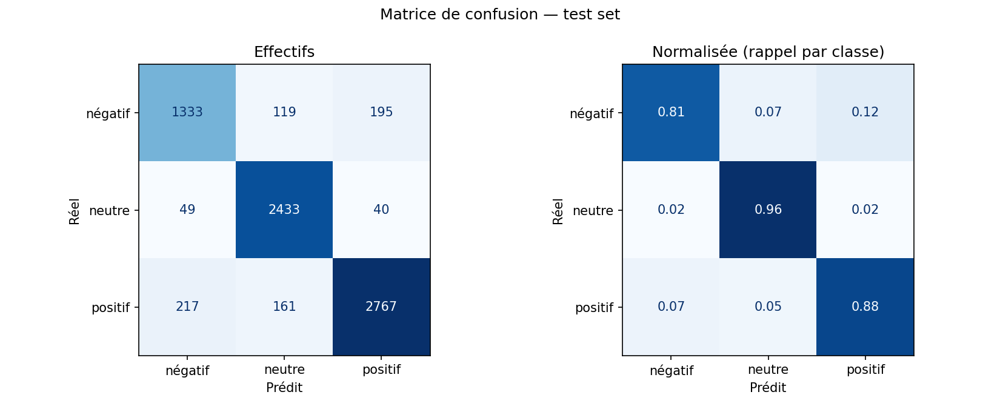

# YouTube Sentiment Analyzer — Projet MLOps complet

Analyse automatique du sentiment (**négatif / neutre / positif**) des commentaires YouTube, du développement
au déploiement cloud :

- un **modèle ML** scikit-learn (TF-IDF + Logistic Regression) entraîné et optimisé ;
- une **API REST FastAPI** conteneurisée avec **Docker** et déployée sur **GitHub Codespaces** ;
- une **extension Chrome** (Manifest V3) qui extrait les commentaires d'une vidéo et affiche les résultats ;
- un **pipeline de tests** (pytest) et un script d'intégration local / cloud.

> Projet réalisé dans le cadre du TP3 « Projet ML complet » — ENSAM Rabat, filière INDIA, 2026/27.

---

## Sommaire

1. [Architecture](#architecture)
2. [Résultats](#résultats)
3. [Structure du projet](#structure-du-projet)
4. [Installation](#installation)
5. [Pipeline ML](#pipeline-ml)
6. [API REST](#api-rest)
7. [Déploiement Docker / Codespaces](#déploiement-docker--github-codespaces)
8. [Extension Chrome](#extension-chrome)
9. [Tests](#tests)
10. [Limites et améliorations](#limites-et-améliorations)

---

## Architecture

```
┌──────────────────────┐   1. extraction    ┌────────────────────────────┐
│   Vidéo YouTube      │ ◄───────────────── │  Extension Chrome (MV3)    │
│   (commentaires DOM) │                    │  content.js + popup        │
└──────────────────────┘                    └─────────────┬──────────────┘
                                                          │ 2. POST /predict_batch
                                                          │    (batchs de 100, HTTPS)
                                                          ▼
                                   ┌──────────────────────────────────────────┐
                                   │  GitHub Codespaces — conteneur Docker    │
                                   │  ┌────────────────────────────────────┐  │
                                   │  │ FastAPI (uvicorn, port 7860)       │  │
                                   │  │  clean_text → TF-IDF → LogReg      │  │
                                   │  │  vectorizer.joblib / model.joblib  │  │
                                   │  └────────────────────────────────────┘  │
                                   └──────────────────┬───────────────────────┘
                                                      │ 3. sentiments + statistiques
                                                      ▼
                                          Popup : graphique, filtres, liste
```

| Composant | Technologies |
|---|---|
| Frontend | Extension Chrome — JavaScript, HTML, CSS (Manifest V3) |
| Backend | FastAPI, Pydantic, Uvicorn |
| ML Engine | scikit-learn (TF-IDF + Logistic Regression), joblib |
| Déploiement | Docker (`python:3.10-slim`) sur GitHub Codespaces |
| Gestion du projet | uv (Python 3.10), Git + GitHub |

**Flux de données :** l'utilisateur ouvre une vidéo → l'extension extrait les commentaires (défilement
automatique) → envoi par batch à l'API cloud → nettoyage + prédiction → retour des sentiments et
statistiques → affichage avec visualisations.

## Résultats

Évaluation sur le test set (7 314 commentaires, jamais vus pendant l'entraînement) :

| Critère du sujet | Objectif | Résultat |
|---|---|---|
| Accuracy | ≥ 80 % | **89,3 %** ✅ |
| F1-score par classe | > 0,75 | négatif **0,821** · neutre **0,930** · positif **0,900** ✅ |
| Inférence, batch de 50 | < 100 ms | **38 ms** en moyenne, 58 ms au p95 ✅ |

<p align="center">
  
</p>

Comparaison des algorithmes (validation croisée 3 folds sur le train) :

| Modèle | Accuracy | F1 macro |
|---|---|---|
| LinearSVC | 0,885 | 0,874 |
| **Logistic Regression** (optimisée, C=10) | **0,877** | **0,866** |
| Logistic Regression (C=1, défaut) | 0,847 | 0,837 |
| Random Forest | 0,769 | 0,709 |
| Complement Naive Bayes | 0,657 | 0,618 |

La Logistic Regression est retenue : performance équivalente au SVC une fois optimisée, et elle fournit
des **probabilités** (`predict_proba`) utilisées pour afficher la confiance de chaque prédiction.
Meilleurs hyperparamètres (GridSearchCV, 64 configurations) : unigrammes, `min_df=2`,
`sublinear_tf=True`, `C=10`, `class_weight='balanced'`.

Rapports détaillés : [`reports/metrics.json`](reports/metrics.json),
[`reports/model_comparison.csv`](reports/model_comparison.csv),
[`reports/gridsearch_results.csv`](reports/gridsearch_results.csv), figures dans
[`reports/figures/`](reports/figures/).

## Structure du projet

```
├── app_api.py                 # point d'entrée de production (port via $PORT, 7860 par défaut)
├── Dockerfile / .dockerignore
├── pyproject.toml / uv.lock   # dépendances (uv) — source de vérité
├── requirements.txt           # dépendances PROD (Docker), exportées depuis uv.lock
├── requirements-dev.txt       # dépendances DEV complètes
├── data/
│   ├── raw/                   # reddit.csv brut (non versionné)
│   └── processed/             # reddit_clean.csv, train.csv, test.csv (non versionnés)
├── models/                    # vectorizer.joblib, model.joblib, model_metadata.json
├── src/
│   ├── data/                  # download_data.py, eda.py, preprocess.py
│   ├── models/                # train.py, evaluate.py
│   ├── api/                   # main.py, schemas.py, model_loader.py
│   └── utils/                 # text.py (nettoyage partagé), logger.py
├── chrome-extension/          # manifest.json, content.js, popup.html/css/js, config.js, icons/
├── scripts/integration_test.py
├── tests/                     # test_text.py, test_model.py, test_api.py
├── reports/                   # métriques, figures, résumés JSON
└── logs/                      # logs du pipeline et de l'API (non versionnés)
```

## Installation

Prérequis : Python 3.10+, [uv](https://docs.astral.sh/uv/), Git, Google Chrome (Docker optionnel en local).

```bash
git clone https://github.com/Inas-21/youtube-sentiment.git
cd youtube-sentiment
uv sync            # crée .venv (Python 3.10) et installe toutes les dépendances
```

Gestion des dépendances :

```bash
uv add <paquet>          # dépendance de production
uv add --dev <paquet>    # dépendance de développement
uv export --no-dev --no-hashes --no-emit-project -o requirements.txt   # régénérer le fichier prod
```

## Pipeline ML

Toutes les étapes sont reproductibles (graine fixe `42`) :

```bash
uv run python -m src.data.download_data   # télécharge data/raw/reddit.csv + statistiques
uv run python -m src.data.eda             # analyse exploratoire → reports/figures/
uv run python -m src.data.preprocess      # nettoyage, dédup, split 80/20 stratifié
uv run python -m src.models.train         # comparaison d'algorithmes + GridSearchCV → models/
uv run python -m src.models.evaluate      # métriques test, matrice de confusion, latence
```

**Données :** dataset *Reddit Sentiment Analysis* — 37 249 commentaires → **36 568** après suppression des
textes manquants, vides et des doublons (train 29 254 / test 7 314). Répartition : 43 % positif,
35 % neutre, 22 % négatif ; déséquilibre compensé par `class_weight='balanced'`.

**Nettoyage** (`src/utils/text.py`, **même fonction à l'entraînement et dans l'API**) : décodage HTML,
suppression des URLs et mentions (`@user`, `u/user`), conversion des emojis en mots
(😂 → *face with tears of joy*), minuscules, suppression de la ponctuation.

## API REST

Lancement local :

```bash
uv run uvicorn src.api.main:app --reload --port 8000
```

Documentation interactive Swagger : <http://127.0.0.1:8000/docs>

> Sous Windows, préférer `127.0.0.1` à `localhost` (évite ~2 s de délai dû à la résolution IPv6).

| Endpoint | Méthode | Description |
|---|---|---|
| `/health` | GET | État de l'API, modèle chargé, version, uptime |
| `/predict_batch` | POST | Sentiment de 1 à 500 commentaires + statistiques globales |
| `/docs` | GET | Documentation Swagger |

**Exemple de requête :**

```bash
curl -X POST http://127.0.0.1:8000/predict_batch \
  -H "Content-Type: application/json" \
  -d '{"comments": ["Great video, I learned a lot", "Worst explanation ever", "Posted at 5pm"]}'
```

**Réponse (extrait) :**

```json
{
  "predictions": [
    {
      "text": "Great video, I learned a lot",
      "label": 1,
      "sentiment": "positive",
      "confidence": 0.9796,
      "probabilities": {"negative": 0.0, "neutral": 0.0204, "positive": 0.9796}
    },
    "…"
  ],
  "statistics": {
    "total": 3,
    "counts": {"negative": 1, "neutral": 1, "positive": 1},
    "percentages": {"negative": 33.33, "neutral": 33.33, "positive": 33.33},
    "average_confidence": 0.9279,
    "sentiment_score": 0.0,
    "dominant_sentiment": "negative"
  },
  "model_version": "20261104-100547",
  "processing_time_ms": 3.23
}
```

**Codes d'erreur :** `422` données invalides (batch vide, commentaire vide, plus de 500 commentaires,
mauvais format) · `503` modèle non chargé · `500` erreur interne (journalisée dans `logs/api.log`).
Les commentaires de plus de 5 000 caractères sont tronqués. CORS configurable via `ALLOWED_ORIGINS`.

## Déploiement Docker / GitHub Codespaces

> Hugging Face Spaces exigeant désormais un abonnement payant pour les Spaces Docker, l'API est déployée
> sur **GitHub Codespaces**. Le Dockerfile est indépendant de l'hébergeur.

Bonnes pratiques appliquées dans le [`Dockerfile`](Dockerfile) : image `python:3.10-slim`, dépendances
installées avant la copie du code (cache des layers), `.dockerignore` en liste blanche, utilisateur
non-root, `HEALTHCHECK` sur `/health`, port 7860 configurable via `PORT`.

**Étapes :**

1. Sur GitHub : **Code → Codespaces → Create codespace on main**.
2. Dans le terminal du Codespace :
   ```bash
   docker build -t youtube-sentiment-api .
   docker run -d --name api -p 7860:7860 youtube-sentiment-api
   docker ps                          # attendre le statut "(healthy)"
   curl localhost:7860/health
   ```
3. Rendre le port public :
   ```bash
   gh codespace ports visibility 7860:public -c $CODESPACE_NAME
   echo "https://${CODESPACE_NAME}-7860.app.github.dev"   # URL publique
   ```
   (ou onglet **Ports** → *Forward a Port* 7860 → clic droit → *Port Visibility* → *Public*)
4. Tester `https://<nom>-7860.app.github.dev/docs`, puis renseigner l'URL dans l'extension (⚙).

**Avant une démonstration :** le Codespace s'arrête après ~30 min d'inactivité. Le relancer depuis
<https://github.com/codespaces>, exécuter `docker start api` et vérifier que le port 7860 est toujours
public. L'URL reste identique tant que le Codespace n'est pas supprimé.

## Extension Chrome

### Installation

1. Ouvrir `chrome://extensions` et activer le **Mode développeur** (en haut à droite).
2. Cliquer sur **Charger l'extension non empaquetée** et sélectionner le dossier `chrome-extension/`.
3. Épingler l'extension via l'icône 🧩.
4. Ouvrir le popup → **⚙** → saisir l'URL de l'API (Codespace ou `http://127.0.0.1:8000`) →
   **Tester l'API**.

### Utilisation

Ouvrir une vidéo YouTube, cliquer sur l'icône puis **Analyser les commentaires**. La page défile
automatiquement pour charger les commentaires, puis les résultats s'affichent.

| Fonctionnalité | Détail |
|---|---|
| Extraction automatique | défilement auto, 50 à 500 commentaires, réponses optionnelles, dédoublonnage |
| Statistiques globales | graphique en anneau, pourcentages, tendance, score (-1 à 1), confiance moyenne |
| Liste des commentaires | badge de sentiment, barre de confiance, texte dépliable |
| Filtres | Tous / Positif / Neutre / Négatif, recherche texte, tri (confiance, plus positifs/négatifs) |
| Mode sombre / clair | mémorisé entre les sessions |
| Copier / exporter | copie texte des résultats filtrés, export CSV |
| Gestion des erreurs | page non YouTube, aucun commentaire, API injoignable, délai dépassé |

### Captures d'écran

<!-- Ajouter les captures dans docs/screenshots/ -->
| Mode clair | Mode sombre |
|---|---|
|  |  |

## Tests

```bash
uv run pytest -v
```

**47 tests réussis + 2 limites connues documentées (`xfail`)** :

| Fichier | Contenu |
|---|---|
| `tests/test_text.py` | nettoyage : URLs, mentions, emojis, HTML, alphabets non latins, entrées vides |
| `tests/test_model.py` | seuils de performance, 14 cas limites (texte très court/long, emojis, langues mélangées), temps d'inférence |
| `tests/test_api.py` | `/health`, batchs de 1/50/500, 5 cas de données invalides (422), 404/405, temps de réponse, CORS |

Tests d'intégration et benchmark (API locale et/ou déployée, cohérence des prédictions) :

```bash
uv run python scripts/integration_test.py --local http://127.0.0.1:8000 \
    --remote https://<nom>-7860.app.github.dev
```

| Batch | Temps total (API locale) | Temps modèle |
|---|---|---|
| 1 | 25 ms | 4 ms |
| 50 | 52 ms | 29 ms |
| 100 | 90 ms | 71 ms |
| 500 | 394 ms | 353 ms |

## Limites et améliorations

**Limites identifiées :**
- **Négation** : les unigrammes ne capturent pas « not good » (prédit positif).
- **Emojis seuls** : peu présents dans le corpus Reddit, souvent prédits neutres.
- **Domaine** : corpus centré sur la politique indienne → généralisation imparfaite à d'autres sujets YouTube.
- **Langues** : modèle entraîné en anglais ; les textes en alphabet non latin tombent souvent en neutre.
- **Hébergement** : un Codespace est éphémère (arrêt après inactivité, quota mensuel).

**Pistes d'amélioration :** modèle Transformer multilingue (DistilBERT, XLM-R), lexique emoji → sentiment,
hébergement PaaS permanent (Render, Cloud Run), CI/CD GitHub Actions (tests + build Docker),
suivi des modèles avec MLflow, monitoring des prédictions en production.
